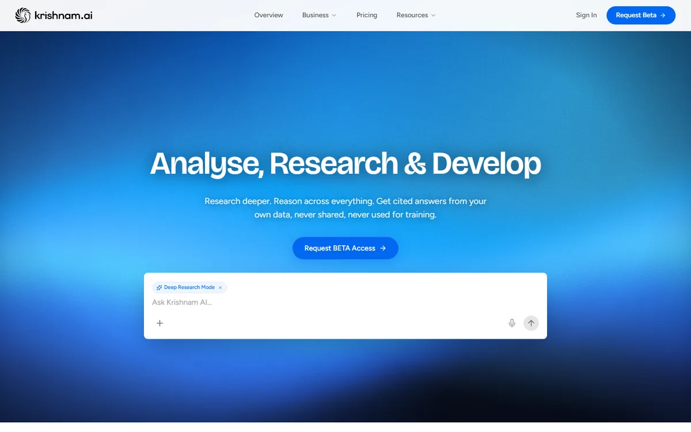
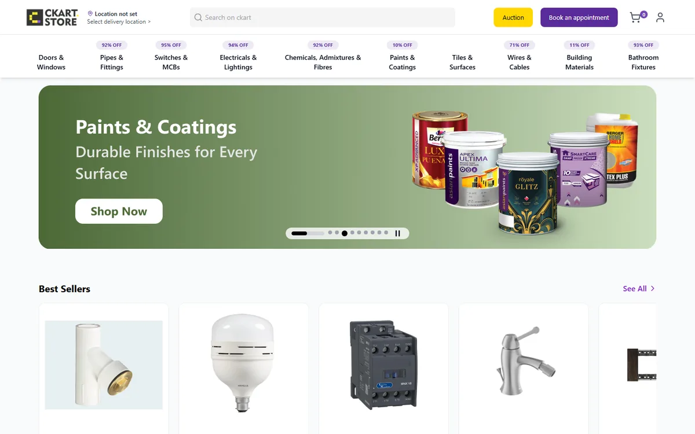
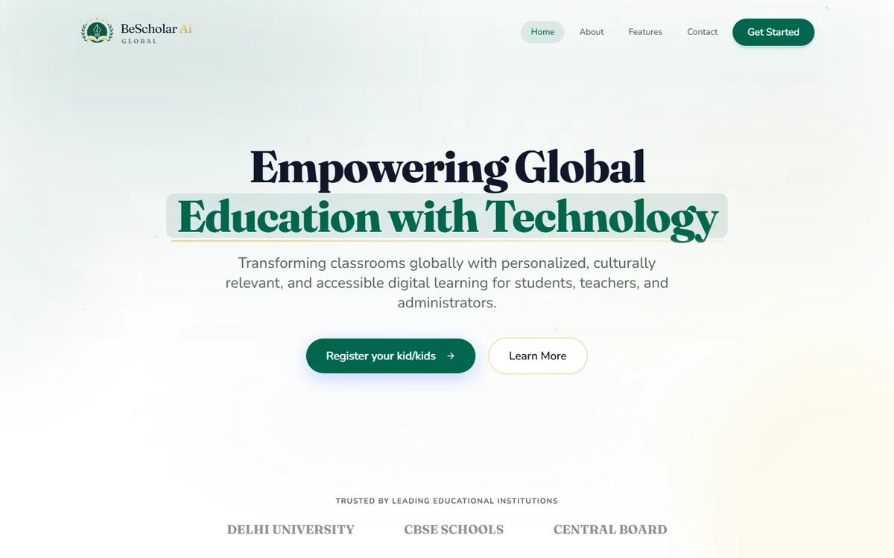
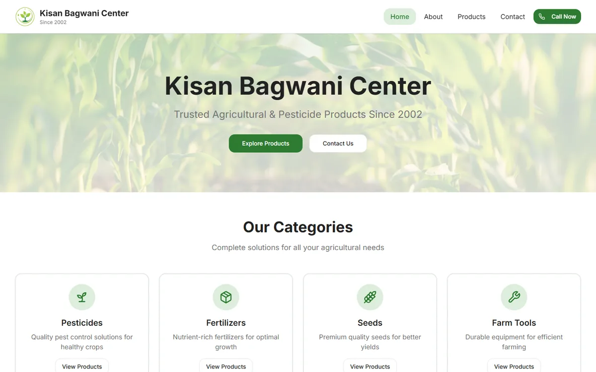
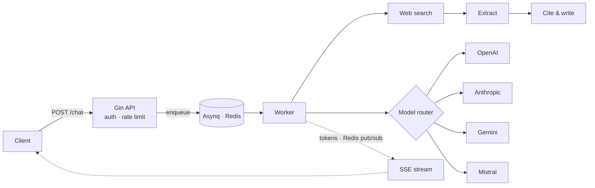

<div align="center">

<picture>
  <source media="(prefers-color-scheme: dark)" srcset="https://readme-typing-svg.demolab.com?font=Geist+Mono&weight=500&size=22&duration=2800&pause=900&color=C6FF00&center=true&vCenter=true&width=640&lines=Full+stack+engineer+%40+SOL9X;Go+%C2%B7+Node.js+%C2%B7+React+%C2%B7+Django;Backends+for+LLM+%26+deep-research+products;B2B+commerce+%26+ERP+platforms" />
  
</picture>

# Hi, I'm Mohd Aahad

I build the backends and the interfaces of products that run in production:<br/>
B2B commerce, school ERP, and LLM platforms. Based in Delhi, India.

<a href="https://mohdaahad.vercel.app"></a>
<a href="https://www.linkedin.com/in/mohd-aahad"></a>
<a href="mailto:mohdaahad2003@gmail.com"></a>

</div>

---

### `$ whoami`

```yaml
role:      Software Developer @ SOL9X (Avtechfin)    # Sep 2024 — present
focus:     Go services, Node.js APIs, React frontends
shipping:  ckart.store · krishnam.ai · bescholarai.com
studying:  MCA, AI & Machine Learning — LPU
location:  Delhi, India (UTC+5:30)
```

- **Commerce.** Multi-vendor B2B/B2C platform with six role-based portals: Buyer, Seller, Brand, Warehouse, Transporter and Super Admin.
- **LLM backend.** Go (Gin) service behind a multi-provider chat and Deep Research product: model routing, Asynq + Redis jobs, SSE streaming.
- **Foundations.** REST APIs, JWT / OAuth, RBAC, PostgreSQL, MySQL, MongoDB, CI/CD with pre-commit checks.

---

### Live work

<table>
  <tr>
    <td width="50%" valign="top">
      <a href="https://krishnam.ai"></a>
      <h4><a href="https://krishnam.ai">Krishnam AI</a></h4>
      LLM chat &amp; Deep Research platform. I built the Go backend: one router in front of every model provider, and a research pipeline that searches, extracts and writes cited reports.<br/><br/>
      <code>Go</code> <code>Gin</code> <code>Asynq</code> <code>Redis</code> <code>PostgreSQL</code> <code>SSE</code>
    </td>
    <td width="50%" valign="top">
      <a href="https://ckart.store"></a>
      <h4><a href="https://ckart.store">CKART</a></h4>
      Multi-vendor B2B/B2C commerce for construction material: auctions &amp; tenders, credit days, live tracking, and PCI-compliant payments across six role-based portals.<br/><br/>
      <code>React</code> <code>Node.js</code> <code>Express</code> <code>MongoDB</code> <code>Redux</code>
    </td>
  </tr>
  <tr>
    <td width="50%" valign="top">
      <a href="https://bescholarai.com"></a>
      <h4><a href="https://bescholarai.com">BeScholar AI</a></h4>
      School ERP: student and teacher management, attendance, timetables and academic content, with central admin dashboards and reporting.<br/><br/>
      <code>React</code> <code>Vite</code> <code>REST APIs</code>
    </td>
    <td width="50%" valign="top">
      <a href="https://kisan-bagwani-center.vercel.app"></a>
      <h4><a href="https://kisan-bagwani-center.vercel.app">Kisan Bagwani Center</a></h4>
      Mobile-first product catalogue for an agri-supplies store running since 2002, with one-tap calling.<br/><br/>
      <code>React</code> <code>TypeScript</code> <code>Tailwind</code> · <a href="https://github.com/mohdaahad/kisna-agri-showcase">source</a>
    </td>
  </tr>
</table>

<details>
<summary><b>How a Deep Research request moves through the Krishnam AI backend</b></summary>
<br/>



</details>

---

### Stack

<p align="center">
  <picture>
    <source media="(prefers-color-scheme: dark)" srcset="https://skillicons.dev/icons?i=go,nodejs,express,ts,react,nextjs,redux,tailwind,python,django,postgres,mysql,mongodb,redis,docker,aws,githubactions,git&theme=dark&perline=9" />
    
  </picture>
</p>

---

### Writing

- [Digital Twin AI: What It Is, How It Works & Real-World Examples](https://blogs.sol9x.com/blog/digital-twin-ai-what-it-is-how-it-works-and-real-world-examples) · SOL9X Blog
- [AI & ML Roadmap (2025): From Beginner to Expert](https://wcblog.in/ai-ml-roadmap-2025-from-beginner-to-expert/) · wcblog.in
- [How to Build a Full-Stack App with the MERN Stack](https://wcblog.in/how-to-build-a-full-stack-app-with-mern-stack/) · wcblog.in

---

### Activity

<picture>
  <source media="(prefers-color-scheme: dark)" srcset="https://github-readme-activity-graph.vercel.app/graph?username=mohdaahad&bg_color=0A0A0B&color=A1A1AA&line=C6FF00&point=FFFFFF&area=true&area_color=C6FF00&hide_border=true&custom_title=Contributions" />
  
</picture>

<div align="center">
<br/>
<sub>Open to full-time roles and freelance work · <a href="mailto:mohdaahad2003@gmail.com">mohdaahad2003@gmail.com</a></sub>
</div>
